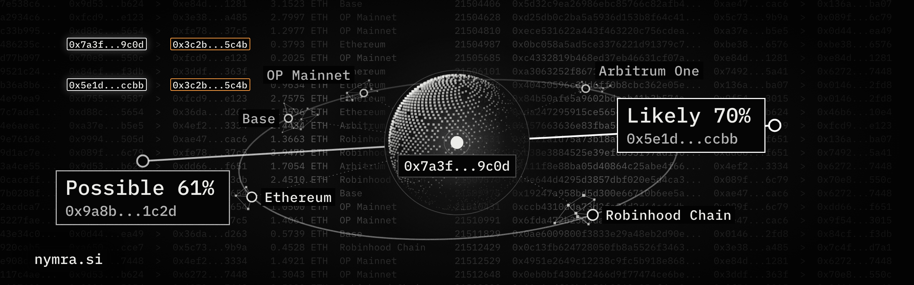

  

# Nymra

**See what the chain reveals.**

Nymra is building privacy superintelligence, one intelligence over every wallet, link and chain. Its first tools score a wallet, show how to fix it, compare two wallets and check a transfer before you send it. They only read, and every rule they use is public.

- Website: [nymra.si](https://nymra.si)
- Docs: [nymra.si/docs](https://nymra.si/docs/)
- Roadmap: [nymra.si/docs/roadmap](https://nymra.si/docs/roadmap/)
- X: [@nymrasi](https://x.com/nymrasi)
- Telegram: [t.me/nymrasi](https://t.me/nymrasi)

## Open repositories

| Repository | What it is |
|---|---|
| [privacy-scan](https://github.com/nymrasi/privacy-scan) | The engine behind the Nymra Privacy Score, with every rule and the score formula in the open |
| [brand](https://github.com/nymrasi/brand) | The Nymra mark, palette and type as files and tokens, with how to use them |
| [telegram-media](https://github.com/nymrasi/telegram-media) | Stickers, custom emoji and videos made for Nymra's Telegram |

The website's own code is not public. The scan engine, its rules and the relay are open source in privacy-scan.
